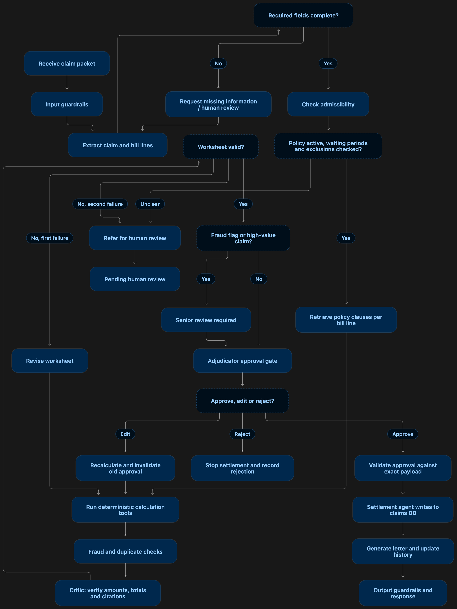

# ClaimSense synthetic-data starter

This is a starter data pack for the ClaimSense capstone. All people, policy IDs,
claim IDs, hospitals, bills, and tariff ranges in the claims/tariff dataset are
synthetic. They are for software development and evaluation only, not real
insurance decisions or medical pricing.

## Layout
- `data/policies/new_india/`: includes the six PDFs uploaded by the user: policy wording, Customer Information Sheet (CIS), prospectus, proposal form, excluded-items list, and claim form. See `manifest.json` for filenames, hashes, and version notes.
- `data/processed/policy_clauses.jsonl`: placeholder schema/example; replace with clauses extracted and reviewed from the exact policy version.
- `data/tariffs/synthetic_tariffs.csv`: 30 procedures × 3 city tiers = 90 synthetic reference ranges.
- `data/claims/development/claims.jsonl`: 20 development claims.
- `data/claims/development/gold_worksheets.jsonl`: reference outcomes for development claims.
- `data/claims/heldout/claims.jsonl`: 60 held-out claims.
- `data/claims/heldout/gold_worksheets.jsonl`: reference outcomes; keep this outside the agent runtime.
- `data/redteam/attacks.jsonl`: example adversarial test cases.
- `src/`, `tests/`, `eval/`: starter project directories.

## Important caveats
1. The claims are synthetic test fixtures, not actual policy interpretations.
2. Gold outcomes use a simplified, explicitly declared demo ruleset. Before testing against a real insurer policy, replace/review the rule configuration and gold labels against the exact official policy wording, policy schedule, and applicable endorsements.
3. Room-rent proportional deductions, waiting periods, sub-limits, co-pay, admissibility, and non-payable item treatment vary by policy/version. Do not assume the example rules are universally valid.
4. Tariff ranges are Option A: synthetic reference ranges, not official hospital tariffs, insurer-negotiated rates, or reimbursement limits. Use only to flag unusual prices for human review; do not use them to decide coverage.
5. The held-out gold file should be access-controlled and never passed to the ClaimSense agent as context.
6. Money is represented in integer INR rupees in this starter dataset. In production, use integer paise or `Decimal` and document rounding rules.
7. Do not use real patient records or personal health information in the capstone dataset.

## Demo ruleset used to generate gold labels
- Policy period: 2026-01-01 through 2026-12-31.
- Initial waiting period: 30 days from policy start; claims admitted before the 30-day period has elapsed are marked `needs_review`/not admissible in the demo fixtures.
- Pre-existing disease waiting period: 36 months; fixtures that explicitly identify a pre-existing condition inside this period are not payable under the simplified demo rules.
- Room cap: min(2% of sum insured, ₹5,000/day).
- ICU cap: min(5% of sum insured, ₹10,000/day).
- Cataract sub-limit: min(25% of sum insured, ₹40,000 per eye).
- Co-pay: 5% of otherwise payable amount.
- `non_payable` line items are excluded from payable amount.
- When room charges exceed the daily room cap, eligible linked room-linked charges are reduced by the same ratio in this simplified demo. The gold worksheet records a proportional-cut factor where relevant.
- These are illustrative rules based on the starter project brief and must be verified against the exact policy document before real use.

## Files
- `manifest.json` records the synthetic dataset version and generation date.
- `data/processed/policy_clauses.jsonl` is a schema example only, not an authoritative clause extract.


## Uploaded New India Assurance documents
The following uploaded PDFs are included under `data/policies/new_india/`:
- `policy_wording.pdf` — POLICY CLAUSES Arogya Sanjeevani
- `customer_information_sheet.pdf` — Customer Information Sheet
- `prospectus.pdf` — Prospectus
- `proposal_form.pdf` — Proposal form
- `excluded_items.pdf` — List of excluded items
- `claim_form.pdf` — Claim Form

The uploaded proposal form shows UIN `NIAHLIP25044V022425`. Treat this as an observed identifier, not proof that every document is the same version. Before encoding rules, cross-check the UIN, effective/version dates and exact wording across the policy wording, CIS, prospectus and excluded-items list. Proposal and claim forms are workflow templates, not coverage contracts.

The workflow diagram:



## Extract and structure policy clauses

Use Python 3.9 or newer. Install the PDF reader dependency and run the pipeline
from the repository root:

```bash
python3 -m pip install -r requirements-dev.txt
python3 src/extract_policy_clauses.py
```

The defaults read `data/policies/new_india/policy_wording.pdf` and write
`data/processed/extracted_clauses_raw.jsonl` and
`data/processed/policy_clauses_structured.jsonl`. Alternate paths can be supplied
with `--pdf`, `--raw-output`, and `--structured-output`. Run the unit tests with:

```bash
python3 -m pytest
```

The structured records are proposed interpretations produced by keyword and
source-span heuristics. Waiting-period duration, applicability, start point and
exceptions remain separate text fields; the pipeline does not turn them into a
single threshold. Every record is marked `not_human_verified`. A qualified
reviewer must compare the extracted text, page references, policy version,
schedule and endorsements before any clause is used for claim decisions.
